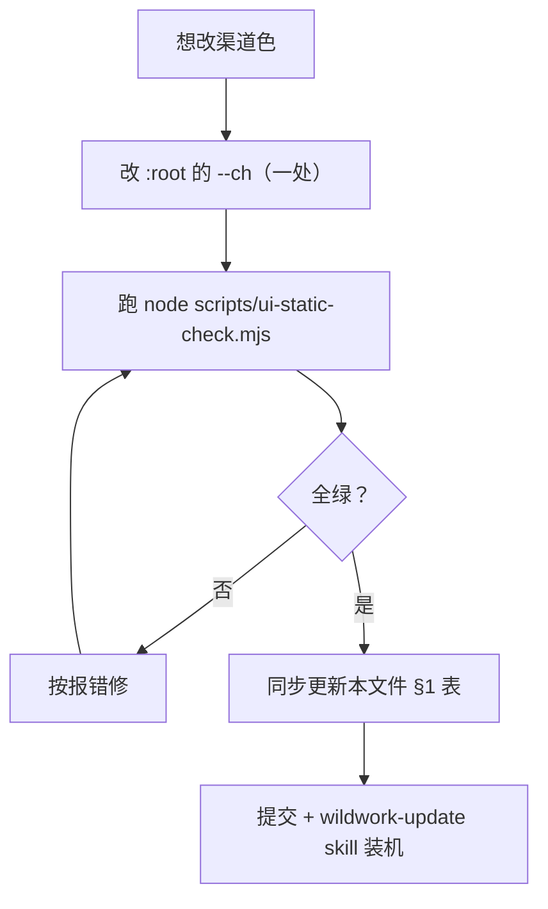

# 渠道配色规范

> **状态：本文件是渠道配色的唯一规范来源。**
> **2026-10-29 起，全部渠道共用单一色 `--ch`（R99 v3）。** 原「23 个品牌色基线 + 逐渠道补齐三处」
> 那套规范已作废，本文随之整体重写。
>
> 关联决议：[`决议项.md`](决议项.md) 的 **R99**（配色单一来源）。

---

## 1. 现在只有一条规则

```
:root { --ch: #a098be; }   /* 所有渠道共用这一个 */
```

渠道身份由**文字**承载（`chLabel()` 是唯一标签源，徽章/按钮/表头/图例四处都显示渠道名）。
色相不再承担第二编码，因此**新增渠道不需要补任何颜色**。

### 为什么从 23 色收回到 1 色

| 理由 | 证据 |
|---|---|
| 暗底上 23 个色相必然拥挤 | 原浅色板（按白底白字选的）搬到 `#131118` 底：**23 个里 21 个低于 4.5:1**，最差 `zcode #581c87` = 1.72、`glm #1e3a8a` = 1.81、`kilo #164e63` = 2.06 |
| 最优化后仍不够分 | 用 OKLCH 保品牌色相、按 ΔE2000 解亮度、约束对底 ≥4.6:1，**最优解仍有 8 对 ΔE00 < 14**（最小 10.55，oczen vs wb） |
| 维护成本是复利 | 新增渠道曾要求同时补 `--ch-<类名>` + `.badge.x` + `.btn.primary.alt.x` **三处**，漏一处就静默降级（历史上真踩过：漏变量 → `chColor()` 回退 `#6366f1` → 图上 6 条线同色） |
| 色相从来不是唯一的编码 | 即使 23 色齐备，用户认渠道靠的还是徽章文字 |

### 取值依据

`#a098be` 低饱和灰紫：

| 指标 | 值 | 说明 |
|---|---|---|
| 对 `--bg #131118` | **6.89:1** | 7px 圆点、描边、文字三种用法都过 WCAG AA |
| 对 `--card #1a1723` | 6.49:1 | |
| 与 `--accent #a78bfa` | **ΔE2000 = 13.7** | 刻意拉开：渠道标记若接近强调色，会被误读成「可点/选中」 |

---

## 2. 三个渲染点（全部读同一个变量）

```mermaid
flowchart LR
  V["`:root` --ch<br/>唯一真源"] --> A["徽章圆点 .badge::before"]
  V --> B["徽章底 --badge-bg<br/>（与 --ch 同族的一层）"]
  V --> C["渠道按钮 hover 描边"]
```

**徽章结构**：底色 `--badge-bg: #2b243f`（对 `--fg` 12.37:1），左侧 5px 圆点 `--ch`（对徽章底 5.42:1）。
**不再有逐渠道 CSS 规则**：`.badge.wb` / `.btn.primary.alt.glm` 这类 24×2 条已合并为各 1 条。
渠道短类名（`wb`/`glm`/…）在 HTML 上**保留**——`applyAcctFilter` 靠 `data-group`，
其它样式规则仍按类名命中，只是不再承载颜色。

---

## 3. 图表：单色明度梯（不是渠道色）

用量模块已从折线图改为**环形 + 占比清单**（见 TP-002 §4.3）。图表需要的区分是
「**同一数据集内不同名次**」，不是「不同渠道」，故用同色相六档明度：

| 档 | 色值 | 语义 | 对 `--bg` |
|---|---|---|---|
| 1 | `#d4c8fe` | 区间总量第 1 名 | 12.04:1 |
| 2 | `#bda7fe` | 第 2 名 | 9.03:1 |
| 3 | `#a688f4` | 第 3 名 | 6.64:1 |
| 4 | `#8e6fd8` | 第 4 名 | 4.83:1 |
| 5 | `#7757be` | 第 5 名 | 3.47:1 |
| 6 | `#613fa3` | 其他（合并） | 2.45:1 |

- 相邻 ΔE2000 **8.3~9.6**，非相邻最小 **16.5**（相邻可辨、隔档绝不混）。
- 第 4~6 档对底对比 < 4.5，但它们是**填充色块**不是文字，不需要文字对比度；
  文字标签（渠道名、占比数字）一律用 `--fg` / `--fg-2`，对比 ≥9:1。
- **档位 = 排名**，超过 5 名合并进第 6 档（扇区超过 6 个就认不出大小差别）。

---

## 4. 变更流程



**必跑**：`node scripts/ui-static-check.mjs`
**必须同步**：本文件 §1 的取值依据表（对底/对卡/对 accent 三项）。

---

## 5. 断言清单（`ui-static-check.mjs` 配色一组）

| 类别 | 断言 |
|---|---|
| 来源唯一 | 只有单一 `--ch`，无任何 `--ch-<类名>` 残留；`chColor()` 只取 `--ch`、不接受 `list` 参数 |
| 徽章 | 统一经 `chBadge()`（唯一出口，含渠道类名）；底色来自变量；文字用 `var(--fg)` 而非写死 `#fff` |
| 无硬编码 | 渠道按钮无 hex；渠道相关 CSS 规则无 hex；CSS 规则无重复定义 |
| 机制下线 | 黄金角配色机制**彻底无残留**（`CUSTOM_GOLDEN_ANGLE` / `customChannelColor` / `relLuminance` / `varyColor` / `hexToHsl` / `hslToHex` 一个都不许剩） |
| 明度梯 | 六档互不相同（同色会让环形糊成一块） |
| 按钮 | 只有一条统一规则，无 24 条逐渠道复制 |
| 一致性 | `RESERVED_CHANNEL_NAMES` / `CH_SUMMARY_ORDER` / `NO_EXPLICIT_CHECKIN` 覆盖全部内建渠道；显示名只有一个来源；CSS 选择器都有渲染点 |

---

## 6. 已知限制（如实记录）

1. **失去「一图分辨多个渠道」的能力**。原来折线图靠色相区分渠道；现在渠道之间只有文字，
   图形上只能区分**排名**。若将来要「按渠道看趋势」，需要另立设计（例如小多图 facet），
   不能靠改回 23 色解决——那会带回 21 个低对比问题。
2. **第 4~6 档对底对比不足 4.5**：仅作填充用；若有人把明度梯拿去当文字色会不达标。
3. **原文档的 ΔE / 白字对比指标作废**：单色后「两两 ΔE」只对明度梯有意义（已核），
   对渠道之间不再有意义。
4. **历史流水仍记旧渠道名与旧色**：不改写历史（不伪造账本）。
